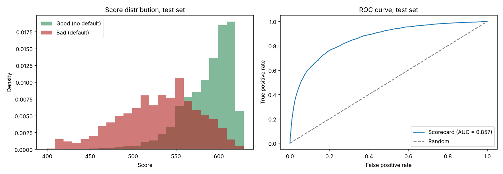
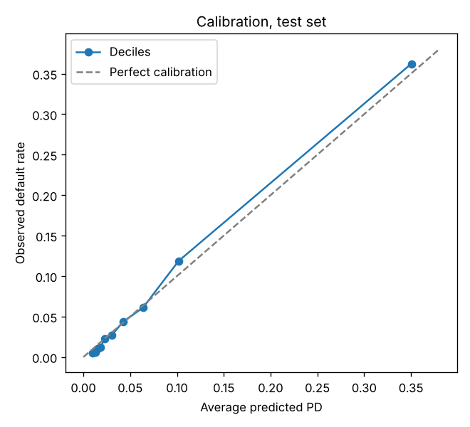

# Credit scorecard: Give Me Some Credit

A credit scorecard that estimates the probability of default (PD) of a borrower and turns it into a score.
It is built on the Kaggle [Give Me Some Credit](https://www.kaggle.com/c/GiveMeSomeCredit) dataset
(150,000 borrowers). The target is `SeriousDlqin2yrs`: 1 if the borrower was 90 days or more past due within 2 years.

The project has two parts: a Jupyter notebook that builds and evaluates the scorecard, and a small Streamlit app
where you enter a borrower's details and get the score and the estimated PD.

## What the notebook does

1. Load the data and check the default rate
2. Clean missing values and outliers
3. Stratified train/test split (70/30), with everything learned on the train set only
4. Bin each variable and compute Weight of Evidence (WoE) and Information Value (IV)
5. Fit a logistic regression on the WoE variables
6. Convert the model into a points scorecard (base score 600, odds 50:1, PDO 20)
7. Evaluate on the test set: AUC, Gini, KS, score distribution and calibration

## Results

- Default rate: 6.68% (10,026 defaults out of 150,000)
- Top Information Values: credit utilization 1.140, 90+ days late 0.892, 30-59 days late 0.739, 60-89 days late 0.601, age 0.225
- Test set: AUC 0.857, Gini 0.715, KS 0.562 (train: 0.8575, 0.715, 0.554, so no sign of overfitting)
- Calibration: the average predicted PD (6.68%) matches the observed default rate (6.68%). The model slightly over-predicts
  the safest deciles (decile 1: 1.0% predicted against 0.5% observed) and under-predicts decile 9 (10.2% against 11.9%).





## Choices worth knowing

- Special codes: the values 96 and 98 in the past-due columns look like codes, and those borrowers default 54.6% of the time,
  so I capped the counts at 10 instead of deleting the rows.
- `DebtRatio` above 5 is set to missing. Almost all of those rows have no income, so the column holds a raw amount there and not a ratio.
- Missing income and missing debt ratio get their own bin. Missing dependents are filled with the train median.
- No class weights in the logistic regression, so the predicted PDs stay meaningful.
- Four variables have an IV above 0.5, which usually calls for a leakage check. They are past-due history and utilization,
  which are plausible signals, but the file does not prove they were measured before the 2-year window.

## Run it

```bash
git clone https://github.com/raxhma/credit-scorecard.git
cd credit-scorecard

python -m venv .venv
source .venv/bin/activate        # Windows: .venv\Scripts\activate
pip install -r requirements.txt
```

Download `cs-training.csv` from the [Kaggle competition page](https://www.kaggle.com/c/GiveMeSomeCredit/data)
and put it in the `data/` folder (the file is not in this repository). Then:

```bash
jupyter notebook credit_scorecard.ipynb    # run all cells, it also writes scorecard.json
streamlit run app.py
```

`scorecard.json` is already included, so the app works even before you run the notebook.

## Files

- `credit_scorecard.ipynb`: the full notebook, with outputs
- `app.py`: the Streamlit app (score a borrower, what-if comparison, how it works)
- `scorecard.json`: the scorecard (bins, points, scale), written by the notebook and read by the app
- `figures/`: plots saved by the notebook
- `.streamlit/config.toml`: theme of the app
- `requirements.txt`: dependencies (the versions I ran it with, on Python 3.12)

## Limits

This is a learning project, not a production IFRS 9 or IRB model. The target is a 2-year serious delinquency flag and not a
regulatory 12-month default. There is no lifetime PD, no macroeconomic scenario, no LGD or EAD, no calibration to a long-run
average default rate, no out-of-time validation (the data has no date) and no stability monitoring. The bins were chosen by hand
from default-rate tables.
